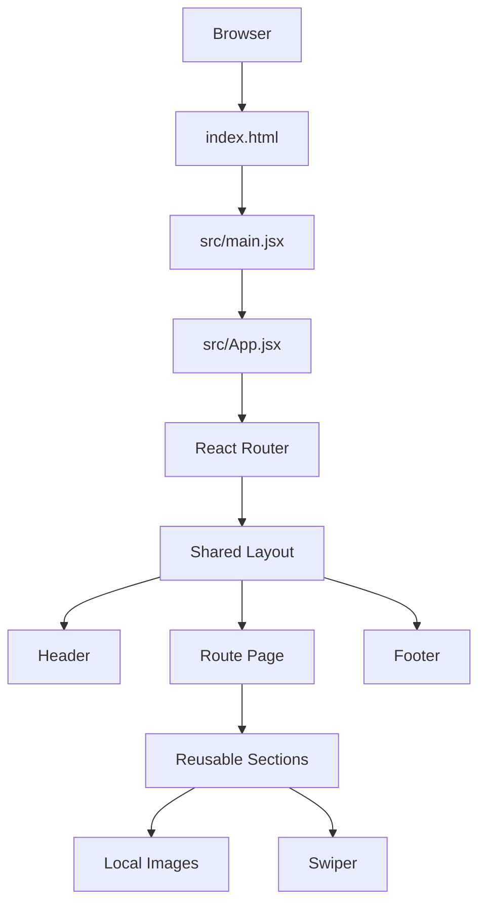

# 🎂 Cake Shop

<p align="center">
  
</p>

<h3 align="center">A bakery storefront UI built with React and Vite</h3>

<p align="center">A visual showcase for cake collections, bakery stories, and editorial content.</p>

<p align="center">
  
  
  
  
  
</p>

---

## 🧁 Overview

Cake Shop is a React 19 and Vite 6 front-end concept for a bakery storefront. It contains Home, Cakes, About, and Blog routes, shared layout components, local images, and a Swiper carousel.

**This is not currently a functioning e-commerce system.** There is no backend, database, authentication, inventory, persistent cart, checkout, payment processing, order management, or contact submission service. Visible order/cart and some navigation controls are presentation placeholders.

## ✨ Current features

| Area | Current implementation |
|---|---|
| 🏠 Home | Hero, introduction, carousel, media section, blog previews, image strip |
| 🍰 Cakes | Hero, reusable image carousel, image strip |
| 📖 About | Introductory and promotional sections |
| 📝 Blog | Static sample cards and placeholder pagination |
| 🧭 Navigation | React Router routes |
| 🖼️ Assets | Local images in public/img |
| 🎠 Carousel | Swiper 11 |

## 🧰 Stack

React 19, React DOM 19, Vite 6, React Router DOM 7, Swiper 11, Bootstrap, Font Awesome, Google Fonts, ESLint 9, npm.

## 🚀 Run locally

Requirements: Git, Node.js compatible with the declared Vite version, and npm.

```bash
git clone https://github.com/Brajesh31/Cake-Shop.git
cd Cake-Shop
npm ci
npm run dev
```

Vite prints the local URL, usually http://localhost:5173.

| Command | Purpose |
|---|---|
| npm run dev | Start development server |
| npm run lint | Run ESLint |
| npm run build | Build static files into dist/ |
| npm run preview | Preview the production build |

There is currently no automated test script.

## 🗺️ Routes

| Path | Page |
|---|---|
| / | Home |
| /cakes | Cakes |
| /about | About |
| /blog | Blog |

These are browser routes, not API endpoints. Configure the static host to return index.html for application routes so direct navigation and refresh work.

## 🏗️ Runtime flow



The current app is client-side only. It does not call a Cake Shop API or database.

## 📁 Project structure

```text
Cake-Shop/
├── .github/
│   ├── ISSUE_TEMPLATE/
│   ├── PULL_REQUEST_TEMPLATE.md
│   └── workflows/
├── docs/
│   ├── architecture/
│   ├── design/
│   ├── engineering/
│   ├── operations/
│   ├── product/
│   ├── quality/
│   ├── security/
│   └── templates/
├── public/img/
├── scripts/
├── src/Views/
│   ├── Layout/
│   └── Pages/
├── src/App.jsx
├── src/App.css
├── src/main.jsx
├── src/index.css
├── package.json
└── package-lock.json
```

## 📚 Documentation

Start with [the documentation index](docs/README.md). The docs cover product requirements, user stories, use cases, architecture, design system, accessibility, SEO, front-end standards, browser support, technical debt, testing, performance, security, deployment, operations, and troubleshooting.

Reusable forms and review checklists are in [docs/templates](docs/templates/README.md).

## 🤝 Contributing

Read [CONTRIBUTING.md](CONTRIBUTING.md), use the GitHub issue templates, and follow the pull request checklist. Visual changes should include screenshots and responsive checks.

## 🔐 Security

Never commit credentials or put secrets in VITE_ variables. Report vulnerabilities privately using [SECURITY.md](SECURITY.md).

## 📄 License

Project source is licensed under MIT. See [LICENSE](LICENSE). Third-party libraries, fonts, CDN resources, and images may have separate terms. Confirm media rights before commercial redistribution.

---

<p align="center">Made with care for the craft of the web and the joy of cake. 🍰</p>

_Last updated: 2026-11-17 09:46 UTC
