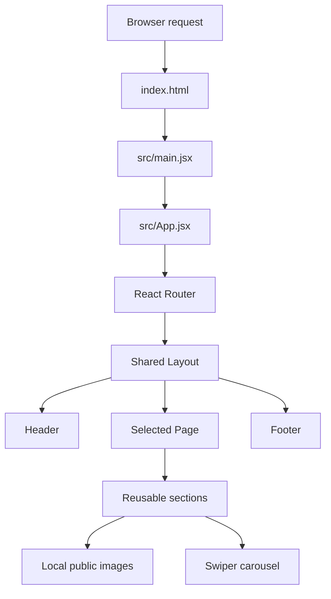

# 🎂 Cake Shop

<p align="center">
  
</p>

<h3 align="center">A bakery storefront UI built with React and Vite</h3>

<p align="center">
  A responsive visual showcase for cake collections, bakery stories, and editorial content.
</p>

<p align="center">
  
  
  
  
  
</p>

---

## 🧁 Project overview

Cake Shop is a client-side React application for a bakery storefront concept. It showcases a home page, cake gallery, about page, and blog layout with shared navigation, footer components, image sections, and a Swiper carousel.

**Scope matters:** this repository currently delivers a front-end presentation. It does not include a backend, database, customer accounts, product inventory, a persistent cart, order processing, payment processing, or a working contact submission service. Visible order/cart controls are presentation placeholders until those features are deliberately implemented.

## ✨ What the current app includes

| Area | Current implementation |
| --- | --- |
| 🏠 Home | Hero, introduction, cake carousel, media section, blog previews, image strip |
| 🍰 Cakes | Hero, reusable image carousel, image strip |
| 📖 About | Introductory content and shared promotional sections |
| 📝 Blog | Static sample blog cards and placeholder pagination |
| 🧭 Navigation | React Router browser routes |
| 🧩 Shared UI | Header, footer, layout, button, blog and image components |
| 🖼️ Assets | Local images in `public/img` |
| 📱 Carousel | Swiper 11 |

## 🧰 Technology stack

- **React 19** and **React DOM 19**
- **Vite 6** for development and production bundling
- **React Router DOM 7** for client-side routes
- **Swiper 11** for the carousel
- **Bootstrap**, **Font Awesome**, and **Google Fonts** for selected presentation assets
- **ESLint 9** for static code checks
- **npm** and the committed `package-lock.json` for dependency management

## 🚀 Getting started

### Prerequisites

- Node.js compatible with the Vite version declared by this project
- npm
- Git

### Installation

```bash
git clone https://github.com/Brajesh31/Cake-Shop.git
cd Cake-Shop
npm ci
npm run dev
```

Vite prints the local development URL in the terminal. The default is usually `http://localhost:5173`.

### Available scripts

| Command | Purpose |
| --- | --- |
| `npm run dev` | Start the local Vite development server |
| `npm run build` | Generate the production bundle in `dist/` |
| `npm run preview` | Preview the generated production bundle |
| `npm run lint` | Run ESLint |

There is currently no test script or automated test suite in `package.json`.

## 🗺️ Application routes

| URL | Page |
| --- | --- |
| `/` | Home |
| `/cakes` | Cakes |
| `/about` | About |
| `/blog` | Blog |

These are browser routes, not API endpoints. Hosting must rewrite unknown application paths to `index.html` so direct visits and refreshes work.

## 🏗️ How the application works



The app is a static client-side application. It currently has no service/API or database layer.

For component boundaries and routing details, see [Architecture](docs/architecture.md).

## 📁 Repository structure

```text
Cake-Shop/
├── .github/
│   ├── ISSUE_TEMPLATE/
│   ├── PULL_REQUEST_TEMPLATE.md
│   └── workflows/
├── docs/
│   ├── architecture/
│   ├── design/
│   ├── operations/
│   ├── product/
│   ├── quality/
│   ├── security/
│   └── templates/
├── public/
│   └── img/
├── src/
│   ├── Views/
│   │   ├── Layout/
│   │   └── Pages/
│   ├── App.css
│   ├── App.jsx
│   ├── index.css
│   └── main.jsx
├── .env.example
├── CONTRIBUTING.md
├── CODE_OF_CONDUCT.md
├── LICENSE
├── README.md
├── SECURITY.md
└── package.json
```

## 🧭 Documentation

| Guide | Description |
| --- | --- |
| [Documentation index](docs/README.md) | Documentation map and ownership |
| [Product brief](docs/product/project-brief.md) | Purpose, users, goals, and non-goals |
| [Features and limitations](docs/product/features.md) | Implemented UI versus planned commerce functionality |
| [User journeys](docs/product/user-journeys.md) | Current visitor journeys and gaps |
| [Architecture](docs/architecture.md) | Runtime, component hierarchy, routes, dependencies |
| [System diagrams](docs/architecture/diagrams.md) | Mermaid context, component, and deployment diagrams |
| [Design and accessibility](docs/design/accessibility.md) | UI, responsive, and inclusive design checklist |
| [Installation](docs/installation.md) | Local setup |
| [Development](docs/development.md) | Contribution workflow and coding practices |
| [Testing strategy](docs/quality/testing-strategy.md) | Quality plan and test coverage gaps |
| [QA checklist](docs/quality/qa-checklist.md) | Manual verification checklist |
| [Security](docs/security/threat-model.md) | Current risk assessment and future service guidance |
| [Deployment](docs/deployment.md) | Static hosting and SPA rewrite |
| [Operations](docs/operations/runbook.md) | Release, rollback, and incident handling |
| [Troubleshooting](docs/troubleshooting.md) | Known local and deployment issues |
| [API status](docs/api.md) | Confirms there is no application API today |

## 🛣️ Roadmap

See [ROADMAP.md](ROADMAP.md) for a phased plan. The highest-priority work is to make existing controls honest and accessible, establish a repeatable quality gate, and decide whether the project should remain a static showcase or become a real commerce application.

## 🤝 Contributing

Please read [CONTRIBUTING.md](CONTRIBUTING.md), follow the pull request template, and use the issue templates when reporting bugs or proposing features.

## 🔐 Security

Do not commit secrets, private customer information, payment details, or production credentials. Report vulnerabilities privately using [SECURITY.md](SECURITY.md).

## 📄 License

The repository's project source is licensed under the MIT License. See [LICENSE](LICENSE). Third-party packages, fonts, CDN resources, and image assets may have separate terms. Verify those before redistribution or commercial use.

---

<p align="center">Made with care for the craft of the web and the joy of cake. 🍰</p>

_Last updated: 2026-11-17 09:44 UTC
