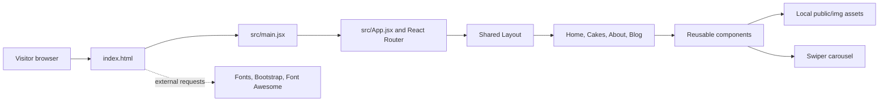
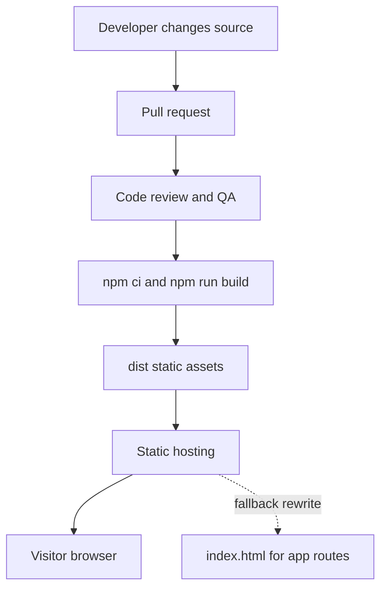
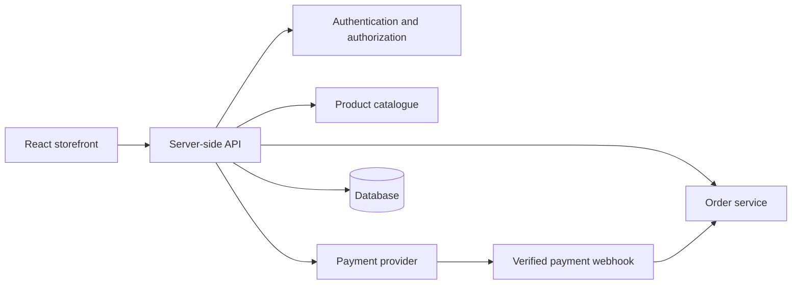

# 🏗️ Architecture diagrams

All diagrams in this guide describe the current code unless explicitly marked as future-state.

## 1. Current runtime context



## 2. Current route and component flow

```mermaid
flowchart TD
  App[src/App.jsx] --> Router[BrowserRouter]
  Router --> Layout[Layout]
  Layout --> Header[Header]
  Layout --> Main[main]
  Layout --> Footer[Footer]
  Main --> Home[/ route: Home]
  Main --> Cakes[/cakes route: Cakes]
  Main --> About[/about route: About]
  Main --> Blog[/blog route: Blog]
  Home --> Sections[Section components]
  Cakes --> Carousel[Section3 carousel]
  About --> Sections
  Blog --> BlogCards[Blog card components]
```

## 3. Current deployment flow



## 4. Future commerce architecture, not implemented



## Diagram maintenance

Update the current-state diagrams whenever route structure or application boundaries change. Keep future-state diagrams clearly labeled until code exists.
