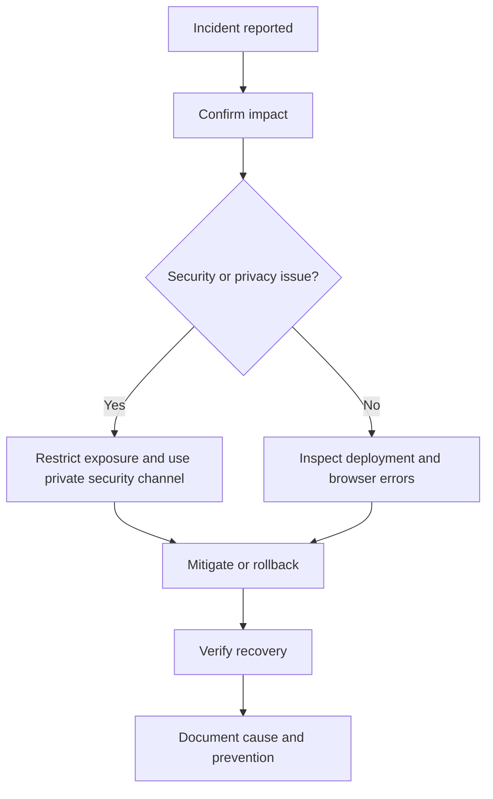

# 🚨 Incident response

## Severity guide

| Severity | Example | Response |
| --- | --- | --- |
| Critical | Site serves malicious content or exposes private information | Disable or roll back deployment and notify maintainers immediately |
| High | Main site or all route navigation unavailable | Restore last known good deployment |
| Medium | One page, asset group, or key interaction broken | Mitigate and prepare a corrective release |
| Low | Cosmetic defect with a workaround | Track and fix through normal review |

## Response sequence

## Checklist

- [ ] Record incident time and affected URLs.
- [ ] Identify affected visitors and functionality.
- [ ] Preserve relevant deployment logs and error details.
- [ ] Do not publish secrets or personal data in the issue.
- [ ] Roll back or disable affected resources if needed.
- [ ] Verify the fix from a clean browser session.
- [ ] Write a short post-incident report with actions and owners.

For a suspected vulnerability, follow root SECURITY.md rather than disclosing technical exploit details in a public issue.
