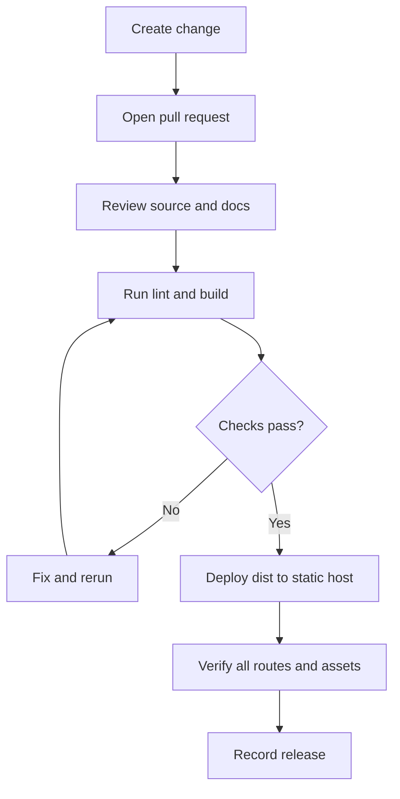

# 🛠️ Operations runbook

## Application profile

Cake Shop is a static Vite-built React application. There is no Node server process required to serve the built static files, no database to migrate, and no background worker in the current repository.

## Local verification

```bash
npm ci
npm run lint
npm run build
npm run preview
```

## Standard release flow



## Deployment verification

After publishing:
- Open the home page.
- Open /cakes, /about, and /blog directly.
- Refresh each route.
- Check browser console and network errors.
- Verify local images and CDN assets.
- Check mobile navigation and carousel interactions.
- Confirm the deployed commit matches the reviewed commit.

## Failure response

If the site is broken:
1. Capture the failing URL, browser, time, and error.
2. Check host deployment status and uploaded artifact.
3. Check SPA rewrite configuration.
4. Check asset paths and CDN availability.
5. Roll back to the last known good static artifact if the issue affects visitors.
6. Record the cause and corrective action.

## Operational boundaries

Do not look for database credentials or payment dashboard credentials for the current app. Those services are not part of this repository.
