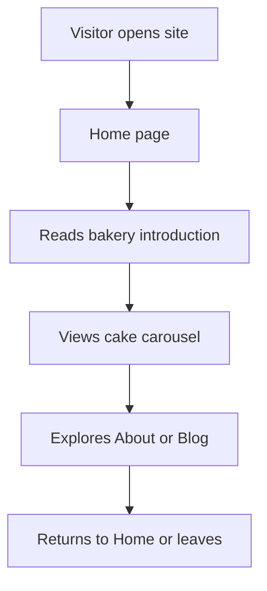
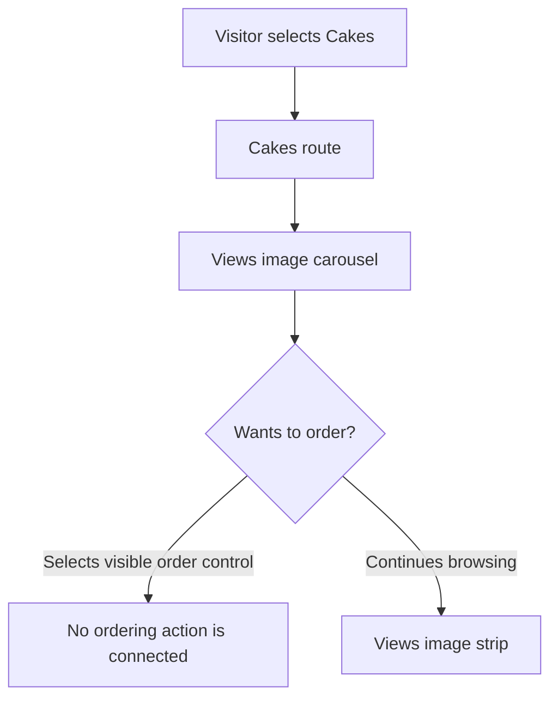
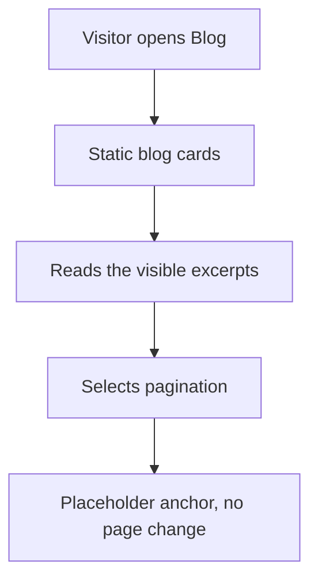
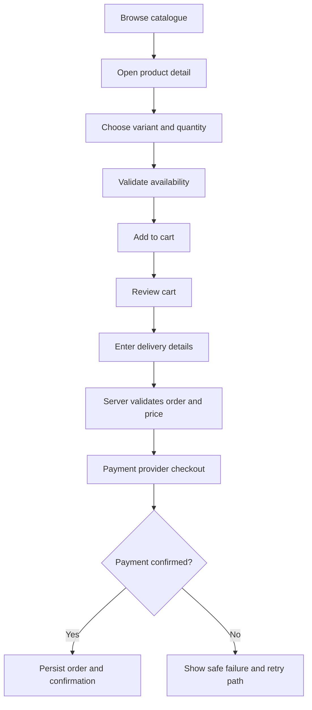

# 🚶 Visitor journeys

## Journey A: Discover the bakery

**Current behavior:** the visitor can navigate among the four configured routes and view local imagery. No analytics or visitor profile is implemented.

## Journey B: Explore cakes

**Current limitation:** the visible ordering language must not be interpreted as an order flow. A real order journey needs product data, availability, pricing, cart behavior, customer details, delivery rules, and secure server-side order creation.

## Journey C: Read the blog

## Future ordering journey, not implemented

This diagram is a planning artifact only. It does not describe existing routes or integrations.
