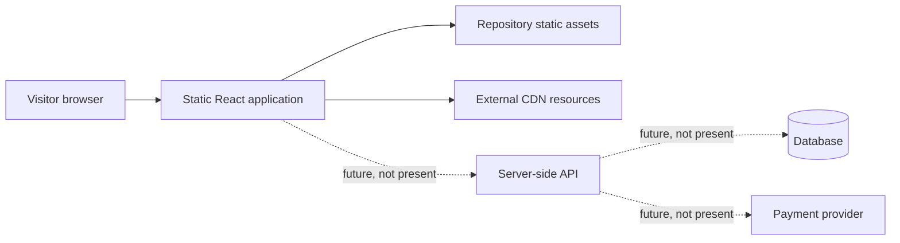

# 🔐 Security threat model

## Scope

The present application is a static browser-rendered UI. It does not currently expose an application backend, database, authentication flow, checkout endpoint, or payment integration. The main security boundary is therefore the browser and the third-party resources loaded by the page.

## Assets and trust boundaries

## Current risks and controls

| Risk | Why it matters | Recommended control |
| --- | --- | --- |
| Third-party CDN compromise or outage | External CSS/JS can affect availability and page behavior | Pin versions, retain integrity metadata where supported, review providers, consider self-hosting |
| Untrusted content in future | User content rendered into the DOM can create XSS risk | Escape by default, sanitize intentionally supported rich text |
| Secrets added to Vite env | Browser-exposed variables are not secrets | Never put credentials in VITE_* variables or client source |
| Misleading purchase controls | Visitors may believe an order was placed | Keep placeholders clearly nonfunctional or implement an actual verified flow |
| Asset licensing | Unverified imagery can create legal and reputational exposure | Record provenance and usage rights |
| Route refresh failures | Host misconfiguration can produce errors on deep links | Configure SPA history fallback |

## Future commerce requirements

Before adding orders or payments:
- Use server-side authorization and validation.
- Recalculate product prices and totals on the server.
- Validate stock and delivery constraints at order creation.
- Never store raw card details.
- Verify payment webhooks using provider signatures.
- Add rate limits and abuse monitoring.
- Minimize personal data and document retention.
- Keep secrets in a server-side secret manager.
- Add security tests and a documented incident procedure.

## Reporting

Follow the private reporting process in the root SECURITY.md. Do not include exploit details, secrets, or personal data in public issue reports.
